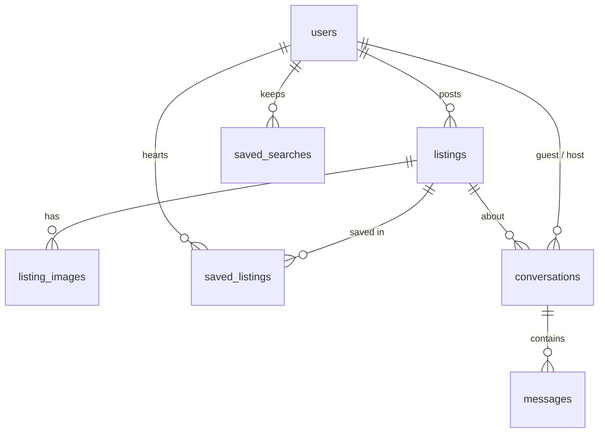

# NestSwap — subleases & lease takeovers

A full-stack marketplace where people post apartments they want to sublease or hand over (lease takeover), and others search, filter, save and message them. Think of a Facebook housing group, but with real filters, a map, private messaging, and trust and safety built in.

**Stack:** React (JavaScript, HTML, CSS) · Java 21 + Spring Boot 3 · MySQL 8 (SQL) · Node.js / npm for the frontend tooling

---

## Features

| Area | What it does |
|---|---|
| **Listings** | Post a sublease, lease takeover or room with up to 10 photos, rent, dates, beds/baths, furnished/pets/utilities. Edit, mark as **taken**, re-open, or delete. |
| **Photos** | Drag & drop upload, preview, reorder, choose a cover, add alt-text. The server checks each file's real type (magic bytes), not just its name. |
| **Search & filters** | Keyword, budget (quick chips + min/max), type, bedrooms, move-in date, city/state, furnished/pets/utilities, roommate preference, and 4 sort orders. Filters live in the URL, so any search can be bookmarked or shared. |
| **Map + distance** (#1) | List / List + map / Map views with price pins. A "within X miles of [campus, workplace or address]" filter, or "use my location". Distance is computed in SQL with the haversine formula. |
| **Messaging** (#2) | Private threads between the poster and the interested person. Unread badges, "Seen" receipts, and an email nudge for new messages. Nobody has to share a phone number. |
| **Saved** (#3) | Heart any listing. Save any search, with optional **email alerts** when new matching places are posted (hourly background job). |
| **Verification** (#4) | 6-digit email code → **Verified** badge, or **Verified student** for `.edu` emails. Badges appear on listings, cards and messages. |
| **Roommates** (#7) | Current roommates, who the household is open to, and the household vibe. Searchers can filter by roommate preference. |
| **Accessibility & mobile** (#9) | Skip link, focus management on navigation, labelled fields with announced errors, keyboard-friendly gallery and photo reordering, alt text, dark mode, reduced motion, and a layout that works down to phone width. |
| **Landlord approval & agreement** (#10) | Posting requires confirming the lease allows subletting, with a checklist. A **subletting guide** page, and a fill-in **sublease agreement** template (pre-filled from a listing) that prints or saves to PDF. |
| **Safety** | Scam tips on every listing and in messages. Email addresses are never shown publicly. |

---

## Quick start (no MySQL needed)

You need **Java 21**, **Maven 3.9+** and **Node 18+**.

```bash
# 1) Backend: in-memory database + sample listings
cd backend
mvn spring-boot:run -Dspring-boot.run.profiles=dev
# → API on http://localhost:8080

# 2) Frontend (new terminal)
cd frontend
npm install
npm run dev
# → open http://localhost:5173
```

Demo login: **maya@emich.edu / password123**. Or sign up yourself. Without email set up, verification codes and alert emails are **printed in the backend terminal**, so look for `===== EMAIL`.

Run the automated API test, which covers register, posting with a photo, filters, the distance search, saving, messaging, permissions and saved searches:

```bash
cd backend && mvn test
```

## Running with MySQL

```bash
docker compose up -d          # starts MySQL 8 with db/user/password = nestswap
cd backend && mvn spring-boot:run
```

No Docker? Install MySQL 8 and run:

```sql
CREATE DATABASE nestswap;
CREATE USER 'nestswap'@'localhost' IDENTIFIED BY 'nestswap';
GRANT ALL ON nestswap.* TO 'nestswap'@'localhost';
```

Tables are created automatically from `backend/src/main/resources/schema.sql` on startup. That file is the real schema, written by hand in SQL. To start with sample data, add `--app.seed-demo=true` once.

### Configuration (environment variables)

| Variable | Default | Purpose |
|---|---|---|
| `DB_URL` / `DB_USER` / `DB_PASSWORD` | local `nestswap` db | MySQL connection |
| `JWT_SECRET` | a placeholder | **Change in production.** Any random 32+ character string |
| `MAIL_HOST`, `MAIL_PORT`, `MAIL_USER`, `MAIL_PASSWORD` | unset | SMTP for real emails. For Gmail use `smtp.gmail.com`, port 587, and an App Password |
| `UPLOAD_DIR` | `uploads` | Where photos are stored |
| `FRONTEND_URL` | `http://localhost:5173` | Used for links in alert emails |
| `CORS_ORIGINS` | `http://localhost:5173` | Allowed browser origins if the frontend is hosted elsewhere |

---

## How it fits together

```
React (Vite) ──fetch /api/*──▶ Spring Boot REST API ──JPA/Hibernate──▶ MySQL
     │                              │
     │                              ├─ JWT login (stateless), BCrypt passwords
     │                              ├─ photos saved to /uploads, served at /uploads/*
     │                              └─ @Scheduled job → saved-search alert emails
     └─ Leaflet + OpenStreetMap tiles, Nominatim for address → coordinates
```

During development, Vite forwards `/api` and `/uploads` to port 8080 (see `frontend/vite.config.js`), so there are no CORS issues.

### Database (7 tables)



Notable SQL decisions:
- Composite index `(status, city, monthly_rent)` for the most common search, and `(latitude, longitude)` for the map.
- `UNIQUE (listing_id, guest_id)` on conversations: one thread per person per listing.
- `ON DELETE CASCADE` everywhere, so deleting a listing cleans up its photos, saves and messages.
- The distance filter first uses a cheap bounding box (can use the index), then the exact haversine distance.

### Backend layout (`backend/src/main/java/com/nestswap`)

| Package | Contents |
|---|---|
| `model` | JPA entities: `User`, `Listing`, `ListingImage`, `SavedListing`, `SavedSearch`, `Conversation`, `Message` + enums |
| `repo` | Spring Data repositories. `ListingSpecs` builds the dynamic WHERE clause for search (including haversine) |
| `dto` | `Dtos` (all request/response JSON shapes) and `ListingSearch` (every filter) |
| `service` | Business logic: `ListingService`, `MessageService`, `SavedService`, `AuthService`, `StorageService`, `MailService`, `SavedSearchAlertJob` |
| `web` | REST controllers + `ApiExceptionHandler` (turns errors into friendly JSON) |
| `security` / `config` | JWT filter, Spring Security rules, CORS, static uploads, demo data |

### Frontend layout (`frontend/src`)

| File | Purpose |
|---|---|
| `pages/Home.jsx` | Search page: hero search, filters, list/map views, sort, paging, save-search |
| `pages/ListingPage.jsx` | Gallery, details, roommates, map, message box or owner tools, safety tips |
| `pages/ListingFormPage.jsx` | Post / edit form with validation, map pin, photos, landlord checklist |
| `pages/Messages.jsx` | Inbox + thread, polls every 5 s |
| `pages/Saved.jsx`, `MyListings.jsx`, `Account.jsx`, `AuthPages.jsx` | Saved items & alerts, your posts, verification, login/sign-up |
| `pages/Agreement.jsx`, `Guide.jsx` | Sublease agreement template and subletting guide |
| `components/*` | `Filters`, `ListingCard`, `ListingsMap`, `LocationPicker`, `PhotoPicker`, small shared bits |
| `api.js`, `auth.jsx` | Fetch wrapper with the login token; login state for the whole app |

---

## REST API

All bodies are JSON unless noted. 🔒 = needs `Authorization: Bearer <token>`.

| Method | Path | Description |
|---|---|---|
| POST | `/api/auth/register` | `{email, password, displayName}` → `{token, user}` |
| POST | `/api/auth/login` | `{email, password}` → `{token, user}` |
| GET / PUT 🔒 | `/api/auth/me` | Your account / update display name |
| POST 🔒 | `/api/auth/verify/request` · `/verify/confirm` | Send code / confirm `{code}` |
| GET | `/api/listings?…filters…&sort=&page=&size=` | Search. Filters: `q city state minRent maxRent minBedrooms type availableBy furnished petsAllowed utilitiesIncluded genderPreference lat lng radiusMiles` |
| GET | `/api/listings/{id}` | Listing detail |
| GET 🔒 | `/api/listings/mine` | Your listings |
| POST / PUT 🔒 | `/api/listings` · `/api/listings/{id}` | **multipart**: `data` (JSON) + `photos` (files) |
| PATCH 🔒 | `/api/listings/{id}/status` | `{status: "ACTIVE" \| "TAKEN"}` |
| DELETE 🔒 | `/api/listings/{id}` | Delete |
| PUT / DELETE 🔒 | `/api/listings/{id}/save` | Save / unsave |
| POST 🔒 | `/api/listings/{id}/conversations` | Message the poster `{body}` |
| GET 🔒 | `/api/conversations` · `/api/conversations/unread` | Inbox · unread count |
| GET / POST 🔒 | `/api/conversations/{id}` · `/{id}/messages` | Open thread (marks read) · send `{body}` |
| GET 🔒 | `/api/saved/listings` | Saved listings |
| GET / POST 🔒 | `/api/saved/searches` | List / create `{name, query, emailAlerts}` |
| PATCH / DELETE 🔒 | `/api/saved/searches/{id}` | Toggle alerts / delete |

---

## Ideas for later

- Real-time chat with WebSockets (Spring's STOMP support) instead of polling.
- Phone verification via Twilio, and a "report listing" button with an admin review page.
- Photo storage on S3 or Cloudinary, with automatic resizing.
- Auto-expire listings after their end date, or ask "still available?" after 30 days.
- Deploy: frontend on Netlify/Vercel, backend on Render/Railway, MySQL on PlanetScale/Railway (set the env vars above).
